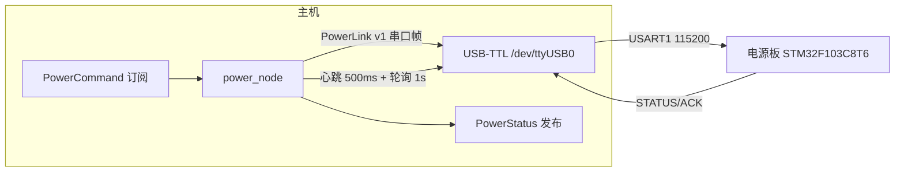

# 40 PowerLink 电源控制节点

> 版本：v1 / 2026-08-24
> 关联：`host/hpm_gateway_ros2_ws/src/hpm_gateway_power/`、`hpm_gateway_msgs`（PowerStatus/PowerCommand）
> 硬件：DOG Power Board D0（STM32F103C8T6），固件见电源板工程 `App/Src/power_link.c`

## 1. 背景与目标

电源板固件已实现 PowerLink v1 二进制协议（USART1 / USB-TTL，115200-8-N-1），提供
10 路电源输出的独立控制与遥测。本文档：

1. 记录**协议文档 ↔ 固件实现 ↔ 硬件基线**三方一致性检查的结论；
2. 描述新增的 **ROS2 电源控制节点**（`hpm_gateway_power`）的设计、消息、部署与验证；
3. 提供无 ROS 的 CLI 工具用于板卡 bring-up 与手动验证。

## 2. 一致性检查结论

### 2.1 检查范围

- 协议文档：`comm_protocol_project/protocol-spec.md`（v1 draft）
- 固件实现：电源板工程 `App/Src/power_link.c`、`power_link.h`、`power_board_app.c`、
  `board_gpio.c`、`main.c`
- 硬件基线：电源板工程 `bringup_project/.../hardware-baseline.md`（schematic p4，
  48 V 引脚实测）

### 2.2 检查项汇总

| 检查项 | 协议文档 | 固件实现 | 结论 |
| --- | --- | --- | --- |
| 物理层 | USART1，PA9 TX / PA10 RX，115200-8-N-1 | 一致（`main.c` + `stm32f1xx_hal_msp.c`，RX 中断已开） | ✅ 一致 |
| 帧格式 | SOF 0xA5 + LEN + SEQ + CMD + PAYLOAD + CRC16(低字节在前) | 一致（`power_link.c` 收发一致） | ✅ 一致 |
| CRC16 | CCITT-FALSE：poly 0x1021，init 0xFFFF，覆盖 LEN..PAYLOAD | 一致 | ✅ 一致 |
| 大端字段 | 多字节字段一律大端 | 一致（`put_u16/u32_be`、`get_u16_be`） | ✅ 一致 |
| 命令码 | 0x01..0x05 / 应答 0x81..0x83 | 一致（`PowerLinkCommand`） | ✅ 一致 |
| 错误码 | OK..NOT_SUPPORTED 0x00..0x06 | 一致（`PowerLinkStatus`） | ✅ 一致 |
| 告警位 | bit0=LOW_VOLTAGE，bit1=COMM_LOST | 一致（`power_link_alarm_flags`） | ✅ 一致 |
| STATUS 布局 | VBAT u32 + NTC1 i16 + NTC2 i16 + STATE u16 + ALARMS u8（11 B 大端） | 一致（`power_link_send_status`） | ✅ 一致 |
| 心跳超时 | 建议 3000 ms | `POWER_LINK_HEARTBEAT_TIMEOUT 3000U` | ✅ 一致 |
| 默认上报间隔 | 1000 ms，0=关闭 | `POWER_LINK_DEFAULT_REPORT_MS 1000U`，0 关推送 | ✅ 一致 |
| 断连策略 | 保持现状 + 告警 COMM_LOST，不断电 | 一致（`comm_lost` 置位，输出不变） | ✅ 一致 |
| 48V 启动门控 | 低压先使能，500 ms 后才允许 48V，否则 BUSY | 一致（`startup_48v_ready` + 500 ms） | ✅ 一致 |
| 低压告警拦截 | 评审建议 A：拒绝新使能（BUSY） | 一致（`low_voltage_alarm` 时 enable → BUSY） | ✅ 一致 |
| SET_POWER_ALL 原子性 | 先校验后一次应用 | 一致（`power_board_app_set_all_channels` 先校验后写 GPIO） | ✅ 一致 |
| 坏帧处理 | 丢弃 + 错误计数，不影响输出 | 一致（`bad_frame_count++`，回到搜 SOF） | ✅ 一致 |
| **48V 通道映射** | **CH6=48V_M1@PA8，CH7=48V_M2@PB13，CH8=48V_M3@PB14，CH9=48V_M4@PB15** | **CH6=M4@PA8，CH7=M1@PB13，CH8=M2@PB14，CH9=M3@PB15** | ❌ **不一致** |

### 2.3 唯一不一致项：48V 通道映射（已按硬件修正）

协议文档 §6.1 把 48V 通道按“M1..M4 顺排”标注，但**硬件基线（schematic p4 + 实测）**
与固件一致为：

| 引脚 | 实际电机 | 协议通道号 |
| --- | --- | --- |
| PA8 | **M4** | **6** |
| PB13 | **M1** | **7** |
| PB14 | **M2** | **8** |
| PB15 | **M3** | **9** |

- **固件是正确的**（`board_gpio.h` 注释与 `board_gpio.c` 开关表均按实际引脚序）；
- **协议文档 §6.1 表格标错**（把 PA8 标成了 M1）；
- 处置：**主机侧一律以硬件/固件为准**。本节点按上述表映射，并在 CLI 中允许直接用
  `M1..M4` 命名以避免混淆；`comm_protocol_project/protocol-spec.md` 的表已同步修正。

> ⚠️ 若此前有主机已按“CH6=M1”使用，会造成“想开 M1 实际开 M4”的错位，务必核对。

### 2.4 固件比协议文档更严的附加规则（非不一致，属安全增强）

固件在协议约定之外还有两条更严的门控，主机收到 `BUSY` 属预期行为：

1. **48V 开启期间禁止关闭任意低压通道**（防止功率级失去辅助电源）→ `BUSY`；
2. 批量 `SET_POWER_ALL` 请求包含 48V 时，低压 6 路必须全开，否则拒绝。

## 3. 协议速览（与固件逐字段对齐）

### 3.1 帧格式

```
┌──────┬──────┬──────┬──────┬──────────────┬─────────────┐
│ SOF  │ LEN  │ SEQ  │ CMD  │ PAYLOAD(LEN) │ CRC16 (2B)  │
│ 0xA5 │ 1B   │ 1B   │ 1B   │ 0..250 B     │ 低字节在前  │
└──────┴──────┴──────┴──────┴──────────────┴─────────────┘
```

- CRC-16/CCITT-FALSE（poly 0x1021，init 0xFFFF），覆盖 `LEN+SEQ+CMD+PAYLOAD`。
- 多字节字段大端；温度 deci-°C（`0x8000`=无效）；电压 mV。

### 3.2 命令与应答

| 命令 | 码 | 载荷 | 应答 |
| --- | --- | --- | --- |
| HEARTBEAT | 0x01 | TOKEN u16 | 0x81 TOKEN u16 + ALARMS u8 |
| SET_POWER | 0x02 | CH u8 + EN u8 | 0x82 CMD + STATUS |
| GET_STATUS | 0x03 | 无 | 0x83 STATUS（11 B） |
| SET_REPORT_INTERVAL | 0x04 | INTERVAL u16(ms)，0=关 | 0x82 CMD + STATUS |
| SET_POWER_ALL | 0x05 | STATE u16 位图 | 0x82 CMD + STATUS |

STATUS(0x83) 载荷：`VBAT u32 + NTC1 i16 + NTC2 i16 + STATE u16 + ALARMS u8`。
错误码：0 OK / 1 UNKNOWN_CMD / 2 BAD_FRAME / 3 BAD_CHANNEL / 4 BAD_PARAM /
5 BUSY / 6 NOT_SUPPORTED。

### 3.3 通道表（修正后，与固件/硬件一致）

| CH | 名称 | 硬件 |
| --- | --- | --- |
| 0 | 12V_1 | 低压 DC-DC |
| 1 | 12V_2 | 低压 DC-DC |
| 2 | 12V_FAN | 低压 DC-DC |
| 3 | 12V_4 | 低压 DC-DC |
| 4 | 5V | 低压 DC-DC |
| 5 | 12V_3 | 低压 DC-DC |
| 6 | **48V_M4** | PA8 PWR_ON（低有效） |
| 7 | **48V_M1** | PB13 PWR_ON（低有效） |
| 8 | **48V_M2** | PB14 PWR_ON（低有效） |
| 9 | **48V_M3** | PB15 PWR_ON（低有效） |

## 4. 电源控制节点设计

### 4.1 架构



- 纯 Python（`ament_python`），仅依赖 `rclpy` + `hpm_gateway_msgs` + `pyserial`，
  避开本工程 C++ 节点在容器内的 CMake 兼容问题，与 `send_reference_motor_commands.py`
  同一运行路径。
- 协议编解码在 `power_link_protocol.py`（无 ROS 依赖），与固件逐字段对齐，
  便于独立测试与 CLI 复用。

### 4.2 包结构

```
host/hpm_gateway_ros2_ws/src/hpm_gateway_power/
  hpm_gateway_power/
    power_link_protocol.py   # 协议客户端：帧/CRC/解析/序号/重传
    power_node.py            # ROS2 节点
    power_board_cli.py       # 无 ROS CLI（bring-up）
  launch/power_node.launch.py
  config/power_node.yaml
  tests/                     # 单测 + 固件仿真端到端测试
  README.md
host/hpm_gateway_ros2_ws/src/hpm_gateway_msgs/
  msg/PowerStatus.msg        # 新增
  msg/PowerCommand.msg       # 新增
```

### 4.3 消息定义

`PowerStatus.msg`（遥测）：

```text
builtin_interfaces/Time stamp
uint32 battery_mv        # VBAT, mV
int16  ntc1_deci_c       # 0.1°C，-32768=无效
int16  ntc2_deci_c
uint16 output_state      # bit n = 通道 n 状态
uint8  alarms            # bit0=LOW_VOLTAGE, bit1=COMM_LOST
bool   comm_lost         # 主机侧链路看门狗（>3s 无合法帧）
uint8  last_ack_cmd      # 最近 CMD_ACK 回显命令码
uint8  last_ack_status   # 最近 CMD_ACK 状态码
bool   last_ack_ok       # 最近命令是否 OK
```

`PowerCommand.msg`（控制）：

```text
builtin_interfaces/Time stamp
uint8  channel      # 0..9 单通道；255=批量
bool   enable       # 单通道：true=允许输出
uint16 state_mask   # 批量：10 位目标状态位图
```

### 4.4 节点参数（`config/power_node.yaml`）

| 参数 | 默认 | 说明 |
| --- | --- | --- |
| serial_port | /dev/ttyUSB0 | 串口设备（RDK 上按实际枚举修改） |
| baud_rate | 115200 | 波特率 |
| heartbeat_period_ms | 500 | 心跳周期 |
| status_period_ms | 1000 | GET_STATUS 轮询周期 |
| cmd_timeout_ms | 100 | 单次应答超时 |
| cmd_retries | 2 | 超时重传次数（≤3，遵循协议 §4.2） |
| report_interval_ms | 0 | 0=关闭板卡周期推送，由主机轮询 |
| status_topic | /hpm_gateway/power_status | 遥测话题 |
| command_topic | /hpm_gateway/power_command | 命令话题 |

话题 QoS 使用 `RELIABLE / KEEP_LAST(10)`（命令路径可靠，避免丢命令）。

### 4.5 行为与时序

1. **启动**：打开串口 → `SET_REPORT_INTERVAL(0)`（失败不致命）→ 启动定时器。
2. **心跳**（默认 500 ms）：发 `HEARTBEAT`，维持板卡 `last_rx` 并清除 COMM_LOST。
3. **轮询**（默认 1000 ms）：发 `GET_STATUS`，解析后发布 `PowerStatus`。
4. **命令**：收到 `PowerCommand` → `SET_POWER`（单通道）或 `SET_POWER_ALL`（批量），
   记录 `last_ack_*` 到状态消息，便于运维看到 BUSY/BAD_PARAM 等被拒原因。
5. **看门狗**：主机侧 3 s 无任何合法帧 → `comm_lost=true`（与板卡侧 COMM_LOST 告警
   独立，二者会同时亮起）。
6. **重传**：应答超时 100 ms 后用**同 SEQ** 重传（`SET_POWER` 幂等，安全）。

### 4.6 一致性要点（节点 ↔ 固件）

- 帧构造、CRC、解析状态机与固件 `power_link.c` 逐字节对齐；
- 序号回显、CMD_ACK 命令回显校验、STATUS 布局与固件一致；
- 通道表以硬件/固件为准（§2.3、§3.3）。

## 5. 构建、部署与运行

```bash
# 在 RDK（或 ROS2 Humble 容器）内：
cd host/hpm_gateway_ros2_ws
colcon build --packages-select hpm_gateway_msgs
colcon build --packages-select hpm_gateway_power --symlink-install
source install/setup.bash

# 运行（串口按实际修改）
ros2 launch hpm_gateway_power power_node.launch.py
# 或指定串口：
ros2 run hpm_gateway_power power_node --ros-args \
  -p serial_port:=/dev/ttyUSB0 -p status_period_ms:=1000

# 观察 / 命令
ros2 topic echo /hpm_gateway/power_status
ros2 topic pub --once /hpm_gateway/power_command hpm_gateway_msgs/msg/PowerCommand \
  "{channel: 7, enable: true, state_mask: 0}"   # 使能 48V_M1
ros2 topic pub --once /hpm_gateway/power_command hpm_gateway_msgs/msg/PowerCommand \
  "{channel: 255, enable: false, state_mask: 0}"  # 全部断电
```

依赖：RDK/容器需 `pyserial`（`apt install python3-serial` 或 `pip install pyserial`）。

## 6. CLI 工具（无 ROS，bring-up）

```bash
cd host/hpm_gateway_ros2_ws/src/hpm_gateway_power
python3 -m hpm_gateway_power.power_board_cli --port /dev/ttyUSB0 status
python3 -m hpm_gateway_power.power_board_cli --port /dev/ttyUSB0 on M1
python3 -m hpm_gateway_power.power_board_cli --port /dev/ttyUSB0 off all
python3 -m hpm_gateway_power.power_board_cli --port /dev/ttyUSB0 mask 0x03FF
python3 -m hpm_gateway_power.power_board_cli --port /dev/ttyUSB0 monitor
```

通道名支持 `12V_1,12V_2,12V_FAN,12V_4,5V,12V_3`、`M1..M4`、`all`。

## 7. 测试与验证

已在本机（无硬件）运行并通过：

```bash
cd host/hpm_gateway_ros2_ws/src/hpm_gateway_power
python3 -m unittest discover -s tests -v
```

- `test_power_link_protocol.py`：CRC 标准向量（`"123456789" -> 0x29B1`）、帧构造/解析
  回环、坏 CRC 拒绝、超长 LEN 重同步、载荷含 0xA5 无填充、STATUS 解码、通道表。
- `test_power_link_client_sim.py`：固件仿真串口回环，覆盖 GET_STATUS / HEARTBEAT /
  SET_POWER / SET_POWER_ALL / SET_REPORT_INTERVAL 的请求-应答匹配。

目标验证（需真实硬件，未在本机执行）：

1. CRC 错误帧被丢弃、坏帧不改变输出（协议 §4 验证点）；
2. 心跳断连/恢复的告警时序（红灯/蜂鸣/COMM_LOST 上报）；
3. 低压告警下使能返回 BUSY；
4. `SET_POWER_ALL` 原子性与“48V 开启时低压必须全开”门控；
5. 48V 单路控制的物理极性（低有效）与启动门控。

## 8. 安全注意与残余风险

- **断连保持现状**：板卡心跳超时只告警、不断电，负载依赖外部保护（用户已确认的取舍）；
- CRC 只保证链路传输正确，不替代硬件过流/欠压保护（JW7228P UVLO 30 V/65 V 仍在）；
- 首次带载 48V 请使用限流电源、隔离负载与独立物理断开点；
- 48V 通道号易混淆（§2.3），务必按本文档通道表操作。

## 9. 变更记录

| 日期 | 版本 | 变更 |
| --- | --- | --- |
| 2026-08-24 | v1 | 一致性检查 + 新增 `hpm_gateway_power` 节点、`PowerStatus/PowerCommand` 消息、CLI、单测 |
