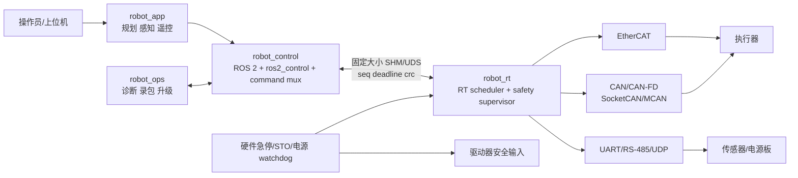

# 总体架构

## 摘要

推荐采用“实时设备平面 + ROS 2 控制平面 + 应用运维平面”的分层模块化单体。进程边界服务于故障隔离和调度确定性，不是为了制造微服务数量。第一版默认两个长期运行进程和若干普通 ROS 2 节点：

- `robot_rt`：C++ 实时运行时，拥有总线、设备 driver、协议 codec、周期调度和安全监督；不链接 DDS/rclcpp。
- `robot_control`：C++ ROS 2 进程，包含 `ros2_control` `controller_manager`、命令仲裁、生命周期和 IPC hardware facade。
- `robot_app`/`robot_ops`：规划、感知、遥控、诊断、录包、标定和 OTA，可按部署拆成多个节点或容器。

实时进程崩溃时由硬件/MCU watchdog切断输出；ROS 2 进程崩溃时 `robot_rt` 只允许执行过期策略，不会继续使用旧命令无限运动。

## 系统上下文

> 需要查看包含交付流水线、扩展入口、IPC 边界、物理安全链路和迁移路径的“大架构图”时，请先看 [13-future-architecture-diagram.md](13-future-architecture-diagram.md)。本节保留精简上下文图，方便快速理解运行时边界。



信任边界：

1. ROS/DDS、参数、网络和第三方应用是不可信输入；只能提交带来源、序号、截止时间的候选命令。
2. IPC 是受版本和 CRC 保护的边界；包格式错误、过期或 schema 不兼容必须拒绝。
3. `robot_rt` 是软件安全边界，但不能替代硬件安全链路。
4. 总线/设备是外部故障源；所有帧、错误和时间戳都要有界消费并计数。

## 进程与模块职责

| 模块 | 所有权 | 允许依赖 | 禁止事项 |
| --- | --- | --- | --- |
| `rt_scheduler` | 周期相位、预算、任务槽 | 单调时钟、静态表 | ROS、文件、动态分配 |
| `safety_supervisor` | arm、限幅、斜率、超时、故障状态 | canonical command/state | 依赖 DDS 才停机 |
| `transport_*` | 总线收发、硬件时间戳、错误计数 | OS/HAL | 了解厂商语义 |
| `framing` | 长度、分片、CRC、重同步 | 固定缓冲区 | 阻塞等待完整帧 |
| `codec_*` | wire bytes 与 typed frame | 标准整数/浮点、纯函数 | 访问 I/O、ROS、全局状态 |
| `device_driver` | 设备生命周期、信号映射、模式 | codec、transport、profile | 直接解析 YAML |
| `ipc` | 命令/状态快照及背压 | 共享内存、原子、CRC | 无界队列/TCP 控制周期 |
| `robot_hardware` | ros2_control facade | IPC、URDF、limits | 直接打开总线 |
| `command_mux` | source lease、优先级、deadman | ROS 消息、策略 | 多个节点直连硬件 |
| `diagnostics/trace` | 指标、事件、录制 | 原子计数、异步导出 | RT 周期打印/落盘 |

依赖方向必须向下稳定：应用 -> ROS 接口 -> 控制 facade -> IPC -> RT 核心 -> driver -> codec/framing -> transport。协议 codec 不得反向依赖 ROS 或设备管理器。

## RT 周期

每个周期按固定顺序执行，设备槽位在启动时排序并锁定：

```text
T0  读取总线完成/消费有限 RX budget
T1  解码帧，更新 device state snapshot
T2  读取最新命令，检查 source lease/deadline/validity
T3  控制器（仅经过验证的 RT controller）与安全 supervisor
T4  限幅、斜率、模式和故障策略最终检查
T5  编码并提交各总线 TX 队列
T6  发布 cycle counter、WCET、jitter、queue watermark 到 flight recorder
```

任何阶段超出预算都不能通过“再重试几次”补偿；下一周期按设备 profile 的 fail-action（通常禁能或安全保持）执行。总线收发可以由 DMA/内核线程完成，但 `robot_rt` 必须对完成时间设上限。

## 状态与命令所有权

### 设备状态

```text
UNKNOWN -> PROBING -> QUARANTINED -> READY -> ACTIVE
                                  \-> DEGRADED -> RECOVERING -> READY
                                  \-> FAULT (需人工/显式复位)
```

- `QUARANTINED` 只允许识别、读诊断和低风险探测，不发送运动输出。
- `ACTIVE` 需要硬件存在、协议版本匹配、安全许可、反馈新鲜且 command lease 有效。
- `FAULT` 不自动重新 arm；恢复必须记录原因、执行清错并重新经过健康门。

### 命令仲裁

所有运动命令先进入 `command_mux`，形成每个设备唯一的 `CanonicalCommand`：

```text
source_id + priority + lease_id + sequence + source_time
  + mode + position/velocity/effort + enable + valid_mask + deadline
```

租约丢失、deadman 松开、序号回退、时间过期或多个同优先级来源冲突时，mux拒绝更新并发出事件；RT 仍会再次检查截止时间和限幅。`TRANSIENT_LOCAL` 不得用于运动命令，避免节点重启重放旧指令。

## 关键数据流与失败语义

| 场景 | 检测 | RT 动作 | ROS/运维证据 |
| --- | --- | --- | --- |
| ROS/DDS 断开 | command age/deadline | 清零或 profile 指定安全保持，撤销 lease | `command_stale`、age 指标 |
| IPC schema/CRC 错 | magic/schema/CRC | 丢包，保留上一有效值仅至其 deadline | `ipc_crc_error` |
| EtherCAT WKC/状态异常 | 每周期 WKC、状态机 | 受影响设备降级/禁能 | WKC、从站状态、raw trace |
| CAN bus-off/错误被动 | SocketCAN/MCAN error frame | 停止该 bus 全部运动轴，不自动 arm | bus state、error counters |
| 反馈 stale/非法浮点 | age、quality、finite/range | 依赖该反馈的控制器停用或安全模式 | sensor/device diagnostic |
| RT deadline miss | monotonic cycle end | 记录并按连续次数阈值降级/停机 | p99.9/max、miss streak |
| robot_rt 进程退出 | systemd/hardware watchdog | 独立 watchdog 切断输出 | core dump、boot reason |

重试只用于幂等、短暂的非实时配置操作；运动帧不做无界重试。所有失败路径定义超时、重试上限、幂等键和回滚动作。

## 配置与数据所有权

- `/etc/robot/<robot_id>/robot.yaml` 是人工配置入口；启动时通过 JSON Schema/语义校验生成不可变 `compiled_profile.bin`。
- `robot_rt` 只读取编译后的静态表，不在周期内解析 YAML/JSON，不接受 ROS 参数直接改总线地址或动态库路径。
- 设备状态的唯一事实来源是 `robot_rt` snapshot；ROS 消息是带时间戳的投影。命令的唯一事实来源是 `command_mux` 输出的 canonical frame。
- 标定和固件版本以带 hash 的 artifact 管理；运行时报告 `config_fingerprint`、`protocol_lock_hash` 和 `device_firmware_id`。

## 迁移现有仓库

1. 保留现有 `GatewayEcat` 的 worker 和 `LatestBuffer`，提取为 `librtcore`/`robot_rt_io` 的第一种 backend；保留旧 topic remap。
2. 将 `motor_config.c` 的轴号/bus/id/protocol 提升为设备描述生成的静态表；旧 API 作为兼容 facade。
3. 将 `protocols/rs06`、`encos`、`yesense` 原样保持纯编解码边界，补齐 registry、版本和 golden vectors。
4. 将 `hpm_gateway_power`、`hpm_gateway_gamepad` 继续作为普通 ROS 2 节点，通过 `command_mux`/服务访问，不把串口阻塞带入 RT。
5. `hpm_gateway_msgs` 在过渡期继续发布，新增 `robot_interfaces` 后用 bridge/remap 逐步迁移。
