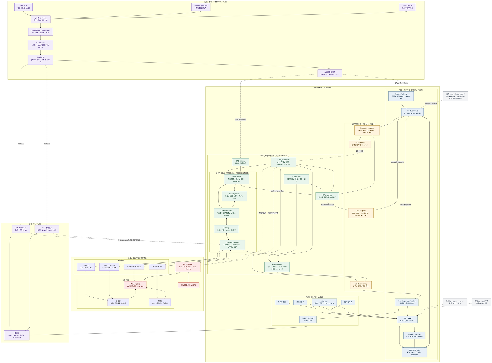
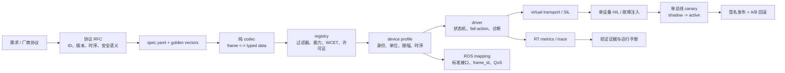
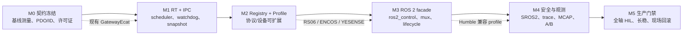

# 未来目标大架构图

文档状态：**提案（目标架构）**。图中的 `robot_rt`、固定大小 IPC、注册表、仿真/HIL 和签名发布链是未来建设目标；现有 `hpm_gateway_control`、SOEM worker、PowerLink 和 gamepad 节点通过迁移适配器逐步接入。

这张图回答四个问题：

1. ROS 2 位于哪里，以及为什么不进入最终安全闭环；
2. 命令、状态、诊断和安全信号分别走哪条路径；
3. 新协议、执行器和传感器从哪里接入；
4. 配置、代码、仿真、HIL、签名发布和回滚怎样形成闭环。

## 总体架构

主图使用原始画布尺寸渲染。文档站点若仍按页面宽度缩放，可在图上右键选择“在新标签页打开图片”，或使用浏览器 `Ctrl` + `+` / `Ctrl` + 鼠标滚轮放大；在支持横向滚动的 Markdown 查看器中可直接拖动查看全图。

### 图例与不变量

| 图中关系 | 含义 | 必须保持的约束 |
| --- | --- | --- |
| 实线向下 | 命令/配置/控制依赖 | 命令只能经 `command_mux`、IPC 和 `safety` 到达设备 |
| 实线向上 | 状态/诊断/观测 | 状态唯一事实来源是 `robot_rt` snapshot；ROS 只是投影 |
| 虚线 | 旁路、迁移或安全触发 | 不把虚线通路当作普通控制闭环；超时必须有明确 fail-action |
| 黄色边界 | 进程间 IPC | 固定大小、schema/version、sequence、deadline、CRC、有限队列 |
| 绿色区域 | 硬实时所有权 | 禁止 DDS、阻塞 I/O、动态分配、日志和运行时插件加载 |
| 红色区域 | 独立安全机制 | 急停、STO、限位、硬件/MCU watchdog 不依赖 ROS 运行 |
| 紫色区域 | 离线交付与验证 | 只有经过校验、签名和预算检查的 artifact 才能激活 |

## 新增协议、执行器或传感器的落点

新增内容必须沿着这条链路进入。协议 codec 不直接接 ROS，ROS 只看到 canonical command/state；执行器和传感器的设备差异由 profile/driver 消化。任何新增实例都要重新计算总线占用、内存、队列和周期预算。

## 分阶段落地

每个里程碑都必须有可回放的原始 trace、配置/协议 hash 和故障证据；未通过门禁的模块保持在 shadow、QUARANTINED 或 inactive slot，不直接成为新的运动写入者。

## 相关设计

- [01-architecture.md](01-architecture.md)：模块职责、状态机、数据所有权和迁移边界
- [03-device-model-and-extension.md](03-device-model-and-extension.md)：设备描述与执行器/传感器接入
- [04-protocol-extension.md](04-protocol-extension.md)：协议分层、注册表、版本和回滚
- [05-ros2-integration.md](05-ros2-integration.md)：ROS 2、`ros2_control`、QoS 与 IPC
- [06-observability-and-debugging.md](06-observability-and-debugging.md)：指标、trace、录包和故障定位
- [09-testing-and-validation.md](09-testing-and-validation.md)：SIL、HIL、故障注入和发布证据
- [10-roadmap.md](10-roadmap.md)：M0--M5 实施计划
